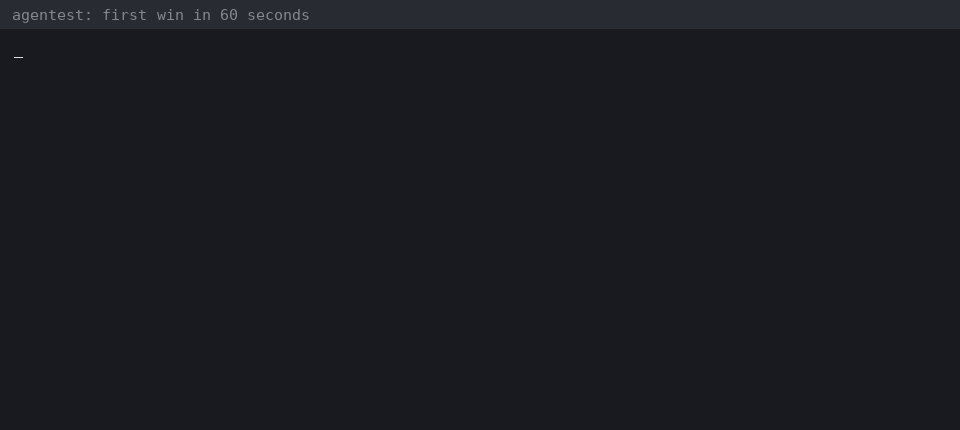

# Can your AI agent pass these tests?

A short, friendly challenge for anyone who builds or tests AI agents. There is no prize, no ranking and no sign-up. You run 130 executable checks on your own agent's recorded traces and see what they say.



*A condensed rendering of the real output from the first run below (evidence text shortened).*

## Step 1: see a failure in 60 seconds

Python 3.11+, nothing else.

```bash
git clone --depth 1 https://github.com/srpadmanabhuni/agentest.git && cd agentest
python3 -m venv .venv && . .venv/bin/activate && pip install -q -e .
agentest std run --agents examples/agnostic_demo/agents --agent refill_bot_buggy \
  --ids T1-018,T2-001,T4-003,T7-014 --format md
```

The bundled sample agent has seeded bugs. Four checks fail, each with one line of evidence. The clean sibling (`--agent refill_bot`) passes everything it can be judged on. Both are teaching fixtures, not real model runs.

## Step 2: run it on your own agent

```bash
agentest std run --otlp my_traces.otlp.jsonl
```

agentest reads the OpenTelemetry GenAI traces your agent already records. No model, API key or network is used, so the same traces always give the same verdicts. A check with no evidence in your trace says `n/a`, never a silent `pass`. No traces yet? [Emit one with the standard library](../examples/otel_plain/emit_trace.py) or [import a native log](walkthroughs/05-bring-your-own-log.md).

## Step 3: share what you found (optional)

Post a redacted result in the [Post your agent report](https://github.com/srpadmanabhuni/agentest/discussions/30) thread:

- which checks failed, `pass` or `n/a`, and the one-line evidence;
- whether the verdict was right. If it was wrong, open a [false positive](https://github.com/srpadmanabhuni/agentest/issues/new/choose) issue. That helps us the most.

Remove personal data and secrets from anything you post.

## Step 4: put it in CI

Add `--strict` and the build goes red when a recorded trace fails a check: [tutorial 4, CI/CD with GitHub Actions](tutorials/04-ci-cd-github-actions.md).

## Ground rules

- **No ranking.** We do not publish a leaderboard of agents or vendors.
- **No prize, no star for entry.** If agentest caught something real for you, a star helps others find it. That is your call.
- **Not certification.** A passing run is test evidence for the checks that had evidence. It is not a compliance determination.
- **Known limits.** Some free-text checks are deterministic English heuristics. See [how it works](HOW-IT-WORKS.md) and [false positives](testers/FALSE-POSITIVES.md). We are constantly working to improve detection; see the [blind-test note](BLIND-TEST.md) for the current precision and recall.

## Where the 130 checks come from

110 are the open [Agentic AI Test Checklist 110](https://huggingface.co/datasets/srinivaspadmanabhuni/agentic-ai-test-checklist-110) test designs on Hugging Face (CC BY 4.0); 20 more are repo extensions. The dataset is where you pick a test; agentest is how you run it.
