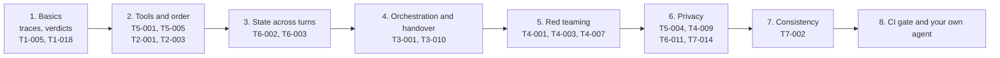

# Agent testing learning roadmap

**A path for testers and developers from first agent test to red teaming and privacy, mapped to checklist IDs and the hands-on pages in this repo.** Each stage takes 30 to 60 minutes with the bundled sample agents. No API key, no model.

| Stage | You learn to | Checklist IDs | Do this |
|---|---|---|---|
| 1. Basics | Read a trace, run agentest, tell `pass`, `fail` and `n/a` apart, spot a success claim the agent did not earn | T1-005, T1-018 | [Start here](START_HERE.md), [reading the report](READING-THE-REPORT.md), [walkthrough 3](walkthroughs/03-claims-success-it-did-not-earn.md) |
| 2. Tools and order | Check tool permissions, hosts and step order | T5-001, T5-005, T2-001, T2-003 | [Tutorial 1](tutorials/01-unauthorized-tool-calls.md), [walkthrough 1](walkthroughs/01-verify-before-acting.md) |
| 3. State across turns | Catch values and ids that drift in a long conversation | T6-002, T6-003 | [Tutorial 3](tutorials/03-state-drift.md) |
| 4. Orchestration and handover | Test approvals, authority and multi-agent handoffs | T3-001, T3-010 | [Tutorial 5](tutorials/05-multi-agent-handoffs.md) |
| 5. Red teaming | Test instructions hidden in documents and tool output | T4-001, T4-003, T4-007 | [Tutorial 2](tutorials/02-prompt-injection.md), [walkthrough 2](walkthroughs/02-instructions-hidden-in-tool-output.md) |
| 6. Privacy | Find personal data and secrets that leak into tools or replies | T5-004, T4-009, T6-011, T7-014 | [Walkthrough 4](walkthroughs/04-personal-data-left-unmasked.md) |
| 7. Consistency | Check that safe behaviour survives paraphrase and translation | T7-002, T7-014 | [Framework](FRAMEWORK.md) (T7 class) |
| 8. CI and your own agent | Gate releases on the checks; bring your own trace | all 130 | [Tutorial 4](tutorials/04-ci-cd-github-actions.md), [walkthrough 5](walkthroughs/05-bring-your-own-log.md), [challenge](CHALLENGE.md) |

Going further: write each kind of test yourself with [Build your own agent test](BUILD-YOUR-OWN-AGENT-TEST.md), and check your understanding with the [interview questions and flashcards](INTERVIEW-QUESTIONS.md).
