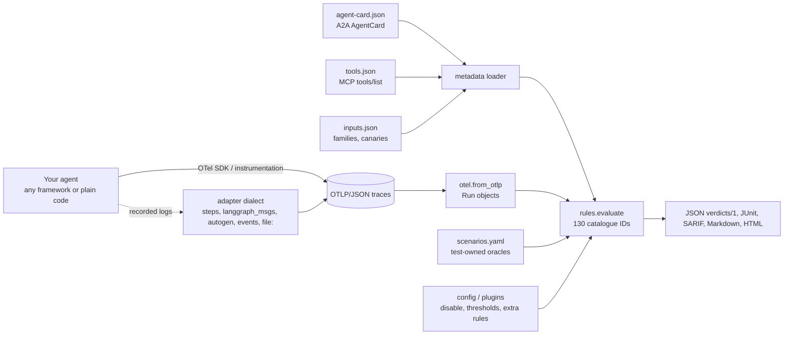
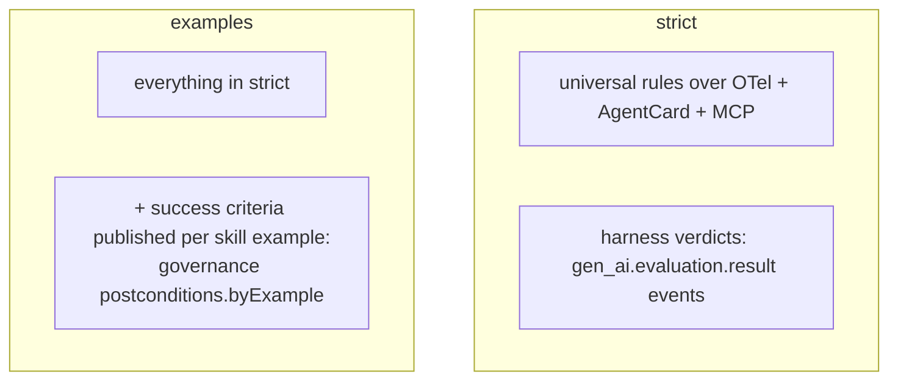
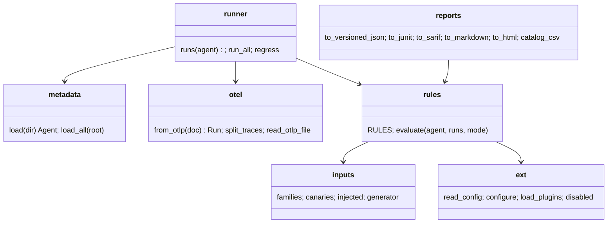

# Concepts and architecture (v3)

agentest v3 judges an agent from **evidence in open formats**, never from the agent's code or name:

| Input | Standard | What agentest learns from it |
|---|---|---|
| Traces | [OpenTelemetry GenAI semantic conventions](https://opentelemetry.io/docs/specs/semconv/gen-ai/) as OTLP/JSON | what the agent was asked, which tools it called with which arguments and results, what it answered, which sub-agents ran, errors, timing, harness evaluations |
| Agent description | [A2A AgentCard](https://a2a-protocol.org/latest/specification/) | skills, skill examples (used to generate inputs), tags/languages, extensions |
| Tool descriptions | [MCP `tools/list`](https://modelcontextprotocol.io/specification/2025-06-18/server/tools) with `annotations` and `inputSchema` (JSON Schema) | which tools change state (`readOnlyHint`), are destructive, idempotent or open-world; argument types and enums |
| Optional governance facts | agentest A2A extension `urn:agentest:a2a-ext:governance:v1` ([schema](../../src/agentest/standards/schemas/governance-extension.schema.json)) | facts no standard carries yet: which tools need approval, data classes, limits, prerequisites, roles |

Rules are written once against these fields and apply to every agent. Nothing in the engine knows an agent id, a
tool name or a domain; see the [agent-independence audit](../standards/AGENT-INDEPENDENCE-AUDIT.md).

## Data flow

## Verdicts

Each catalogue ID gets exactly one of:

- **pass**: the inputs contained the signal the check needs and it held;
- **fail**: the signal was present and the property was violated (the detail names the run and the evidence);
- **n/a**: no standard signal (for example no injection input, or no declared approval policy). n/a is not a pass.

## Two modes

- `--mode strict` uses only rules and evaluation events emitted by your own harness. It never uses expected
  outputs written by the agent's author.
- `--mode examples` (default) additionally applies `postconditions.byExample`: success criteria attached to the
  AgentCard's skill examples. This catches more task-success defects but trusts the published criteria.

## Components

All modules are in `src/agentest/standards/`; they import only the Python standard library, PyYAML and agentest
itself (enforced by `tests/test_no_lock_in.py`).

## What is heuristic

Some checks read English text: success claims, refusals, warnings and injected directives are matched with
regular expressions (`CLAIM_RX`, `NEG_RX`, `DIRECTIVE_WORD` in `rules.py`). They are deterministic and tested,
but they can miss paraphrases or other languages, and can misfire. The [per-test guide](../testers/PER-TEST-GUIDE.md)
marks these IDs. Prefer harness `gen_ai.evaluation.result` events where you can.

## Legacy engines

`agentest run`, `agentest real` and `agentest check` are the v1/v2 engines. They are kept for compatibility and are
profile-based; v3 does not use them. See the [README](../../README.md) for their docs.
