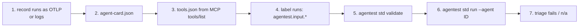

# Onboarding an agent, end to end

No agentest code changes are needed for a new agent; `tests/test_agent_independence.py` proves this with an agent
made only of standard artifacts, and `tests/test_no_lock_in.py` with one made only of traces.

## Route A: traces only (fastest)

```bash
pip install "agentest @ git+https://github.com/srpadmanabhuni/agentest@v3.0.0"
agentest std run --otlp traces.json                        # any OTLP/JSON export, .json or .jsonl
agentest std run --otlp traces.json --card agent-card.json --tools tools.json --format sarif --out agentest.sarif
```

Without a card or tools, every tool is treated as a write and governance checks return n/a. Each OTLP trace is
one run; runs are grouped by `traceId`.

## Route B: an agent folder (repeatable, versioned)



1. **Make a folder** `agents/<your_id>/`. The id is only a label; nothing in agentest depends on it.
2. **Add traces.** Put OTLP files in `agents/<your_id>/traces/` (`*.otlp.jsonl`, `*.json` or OTLP/protobuf `*.pb`),
   or collect them with `agentest std serve`. If your framework writes only native logs, convert them once:

   ```bash
   agentest std import my_logs.jsonl --dialect events --tools agents/<your_id>/tools.json \
       --service <your_id> --out agents/<your_id>/traces/<your_id>.otlp.jsonl
   ```

   Built-in dialects: `steps`, `events`, `openai_agents`, `langgraph_msgs`, `autogen`, `n8n`. For any other log
   format pass `--map map.json` with `"dialect": "file:my_dialect.py"`; the function `to_trace(raw, ep)` fills the
   common episode from one raw record (see
   [examples/agnostic_demo/import/refill_log.py](../../examples/agnostic_demo/import/refill_log.py)).
   Adapters are per framework or per log format, never per agent logic, and they are not kept in the agent folder.
3. **Write the AgentCard and tools**: [AGENT-CARD.md](AGENT-CARD.md).
4. **Label test inputs** on each run's root span (`agentest.input.families`, `agentest.input.injected`, `agentest.test.canaries`): [generating inputs](../testers/GENERATING-INPUTS.md).
5. **Validate**: `agentest std validate --agents agents --agent <your_id>`.
6. **Run**: `agentest std run --agents agents --agent <your_id> --mode strict` and again with `--mode examples`.
7. **Triage**: [reading results](../testers/READING-RESULTS.md) and [false positives](../testers/FALSE-POSITIVES.md).

## Generating new inputs

`agentest std gen --agents agents --agent <your_id>` prints canonical, metamorphic, injection and boundary inputs
built from the card's skill examples and the tools' input schemas. Feed them to your agent, record the traces,
and add them to the folder.

## Exporting

`agentest std export --agents agents --out otlp/` writes every agent's runs as OTLP/JSON, so the evidence can be
loaded into any OTel backend or another tool.
