# Model-driven checks: design (v2.0.0)

Status: **next version, on the `model-driven` branch only.** Not released, not tagged. v1.0.0 on `main`
(per-agent checks in `src/agentest/real/`) is unchanged and remains the reference; both run side by side here.

## Problem

In v1 most real checks are written per agent (`@check("T7-004", "a05")`). Adding an agent means writing Python for
up to 130 IDs. v2 describes each agent **once**, in data, and writes each test **once**, against that description.

## Architecture

```mermaid
flowchart LR
    subgraph Native["Framework-native runs"]
        OA[OpenAI Agents SDK RunItems]
        LG[LangGraph messages / node logs]
        AG[AutoGen AgentChat events]
        CR[CrewAI task outputs / Flows]
        N8[n8n execution data]
        MC[MCP tool calls]
        LI[LlamaIndex steps]
        SA[agentest sample agents]
    end
    Native --> AD[Adapters<br/>agentest.model.adapters<br/>only framework-specific code]
    PR[(Agent profile YAML<br/>profiles/*.yaml)] --> AD
    AD --> TR[Standard trace<br/>trace.schema.json<br/>OTel GenAI aligned]
    PR --> GC[Generic checks<br/>agentest.model.generic<br/>no agent ids]
    TR --> GC
    PR --> GEN[Input generator<br/>metamorphic + adversarial]
    GEN -->|run agent, record| Native
    GC --> RES[Results matrix<br/>pass / fail / n/a]
    RES --> PAR[Parity vs v1<br/>PARITY.md]
    V1[v1 per-agent checks<br/>agentest real] --> PAR
```

## 1. Standard trace (`src/agentest/model/trace.py`, `trace.schema.json`)

One `Episode` per run: `messages`, `tool_calls` (name, arguments, result, `side_effect` read/write/unknown, actor,
call id, error), `state_changes` (executed / pending / unapproved / diff), `approvals`, `handoffs`, `final_answer`,
`final_state` and `error`. The schema is JSON Schema 2020-12; a dependency-free validator ships with it.

Alignment with the OpenTelemetry GenAI semantic conventions
(<https://opentelemetry.io/docs/specs/semconv/gen-ai/>, agent spans
<https://opentelemetry.io/docs/specs/semconv/gen-ai/gen-ai-agent-spans/>): an episode corresponds to an
`invoke_agent` span, a tool call to an `execute_tool` span with `gen_ai.tool.name`, `gen_ai.tool.call.id`,
`gen_ai.tool.call.arguments` and `gen_ai.tool.call.result`; `actor` maps to `gen_ai.agent.name`. Side-effect type,
approvals, handoffs and state changes have no OTel attribute yet; they are agentest extensions (see
`OTEL_MAPPING`). The GenAI conventions are marked *Development* upstream, so names may change; we keep the mapping in
one table rather than in field names.

## 2. Adapters (`src/agentest/model/adapters.py`)

Seven built-in dialects cover all 40 bundled agents; a profile can also name its own adapter file (`adapter: file:adapter.py`). Built-ins: `steps` (plain Python, LangGraph node logs, LlamaIndex, CrewAI task list),
`openai_agents`, `langgraph_msgs`, `autogen` (also AutoGen + MCP), `n8n`, `events` (a13-a25 event logs: LangGraph,
CrewAI, AutoGen, MCP workbenches, OpenAI Agents SDK browser) and `sample`. Adapters only parse; they never decide
which tool writes - the profile does.

## 3. Agent profile (`profiles/<agent>.yaml`, schema in `agentest.model.profile`)

Tools with read/write type, approval-required actions, allowed recipients, limits, sensitive data kinds, canaries,
languages, capabilities (`tools`, `memory`, `retrieval`, `multi_agent`, `approval`), orchestrator actors,
*observations* (where in the recorded output the agent exposes effects, approvals, citations, final answer),
*probe roles* (canonical, empty, readonly, injection, social, metamorphic pairs, approval_scope) and declarative
*success criteria* (`path` + `op` in eq/ne/contains/nonempty/empty/truthy/falsy). Unknown keys are rejected.

## 4. Generic checks (`src/agentest/model/generic.py`)

Built-in generic checks cover the IDs that can be stated over the standard trace alone. Each reads only
`(episodes, profile)`. Every one of the 130 IDs can also be stated as a profile expectation (`expect:` in the profile
or a shared library under `profiles/_lib/`); an expectation is authoritative, the built-in check is the fallback. If the
profile lacks the probe role, capability or observation a check needs, the result is `n/a` with the reason -
applicability is automatic.
Text detectors (success words, PII regexes) are heuristics, as in v1.

## 5. Generator (`src/agentest/model/generator.py`)

From a profile and seed inputs it builds metamorphic variants (case/whitespace, politeness suffix, code-mixed
templates per declared language), an indirect-injection variant carrying the profile canary, in-band approval text,
an out-of-fence recipient, synthetic sensitive values per declared kind, a limit-breaking amount and a blank input.
Each case names the generic check that judges it. Code-mixed templates are not translations.

## 6. Parity and status

`python scripts/model_parity.py` compares every v2 cell with v1.0.0 (frozen baseline `fixtures/real/v1-results.json`) and
writes [PARITY.md](PARITY.md): all 382 v1 failures are reproduced; 0 cells are looser or stricter.

Agnosticism proof: `examples/agnostic_demo/` onboards a plain-Python agent with its own text log using one YAML
profile plus a 24-line `file:` adapter, with no change to check code; its buggy build fails 7 IDs. See
[DEVELOPER-GUIDE.md](DEVELOPER-GUIDE.md) for the full developer approach and the line-count table.

## References

- OpenTelemetry Semantic Conventions for Generative AI (Development status): <https://opentelemetry.io/docs/specs/semconv/gen-ai/>
- Barr, Harman, McMinn, Shahbaz, Yoo. The Oracle Problem in Software Testing: A Survey. IEEE TSE 41(5), 2015. doi:10.1109/TSE.2014.2372785
- Chen, Kuo, Liu, Poon, Towey, Tse, Zhou. Metamorphic Testing: A Review of Challenges and Opportunities. ACM CSUR 51(1), 2018. doi:10.1145/3143561
- Segura, Fraser, Sanchez, Ruiz-Cortes. A Survey on Metamorphic Testing. IEEE TSE 42(9), 2016. doi:10.1109/TSE.2016.2532875
- Greshake et al. Not What You've Signed Up For: Compromising Real-World LLM-Integrated Applications with Indirect Prompt Injection. AISec 2023. doi:10.1145/3605764.3623985
- Yao, Shinn, Razavi, Narasimhan. tau-bench. arXiv:2406.12045
- OWASP Top 10 for LLM Applications 2025: <https://genai.owasp.org/llm-top-10/>
- JSON Schema 2020-12: <https://json-schema.org/draft/2020-12>
