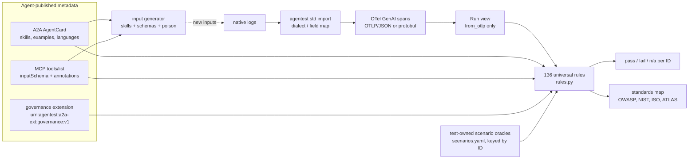

# agentest v3 — standards-based, agent-agnostic design

Status: released as v3.0.0; v3.1.0 removes the legacy v2 engine, adds universal rules for the last 24 scenario-only IDs,
OTLP/protobuf ingest, `agentest std serve`, a pinned semantic-convention mapping and verdicts as OTel events.

## Goal

Every one of the 136 checks (110 catalogue IDs + X-001..X-026) is **one universal rule** that reads only
standard signals. Nothing in the test code, and nothing in an agent's files, is a per-agent expectation.
Facts about an agent exist only as **declarative metadata the agent publishes**:

| What | Standard | File |
|---|---|---|
| Behaviour (what happened) | OpenTelemetry GenAI semantic conventions (pinned in `semconv.yaml`), OTLP/JSON or OTLP/protobuf | `agents/<id>/traces/`, emitted natively or converted once by `agentest std import` |
| Who the agent is, skills, example inputs, languages | A2A AgentCard (protocol 0.3.0) | `agents/<id>/agent-card.json` |
| Tools, input schemas, read/write/destructive/idempotent/open-world | MCP `tools/list` result: `inputSchema` (JSON Schema) + `annotations` | `agents/<id>/tools.json` |
| Governance facts the standards do not cover (approval, data classes, limits, tenancy, prerequisites, roles) | **non-standard** A2A extension `urn:agentest:a2a-ext:governance:v1` (policy-as-data, OPA style) | inside the AgentCard, see [EXTENSION.md](EXTENSION.md) |
| How to read a framework's native logs | field map only (no pass/fail logic), per log format | `agentest std import --dialect` / `--map` (not stored with the agent) |
| Which test input a run answers and its family | root-span attributes `agentest.input.*`, or the AgentCard skill examples | inside the trace |

## Components (`src/agentest/standards/`)

* `otel.py` — `to_otlp(episode)` writes one OTLP/JSON `TracesData` per run: a root `invoke_agent` span
  (`gen_ai.operation.name`, `gen_ai.agent.name`, `gen_ai.input.messages`, `gen_ai.output.messages`),
  one `execute_tool` span per call (`gen_ai.tool.name`, `gen_ai.tool.call.id`, `gen_ai.tool.call.arguments`,
  `gen_ai.tool.call.result`, `error.type`), handoffs as child `invoke_agent` spans, LLM steps as `chat` spans and harness
  verdicts as `gen_ai.evaluation.result` events (`gen_ai.evaluation.name`, `gen_ai.evaluation.score.label` = pass|fail).
  Data the conventions do not cover uses the `agentest.*` attribute namespace (see EXTENSION.md).
  `from_otlp()` rebuilds the `Run` view the rules read; the runner always round-trips through JSON text,
  so rules only see what an OTel collector would store.
* `metadata.py` — loads and validates AgentCard + MCP tools (+ MCP default annotations: unknown tools are writes).
* `inputs.py` — the shared probe vocabulary → input families (canonical, readonly, empty, pii, injection, refusal,
  language_variant, paraphrase, demographic, units, negation …), metamorphic relations, canaries, and
  `generate(agent)`: new inputs from AgentCard skill examples and tool schemas (incl. poisoned tool results).
* `rules.py` — `RULES[id] = (description, rule)`; every rule takes `Ctx(agent, runs, mode)`. Rule kinds:
  state-based (writes, approvals, prerequisites, recipients), metamorphic (outcome signature equal/differ across related
  inputs), spec-derived (JSON Schema enums, MCP annotations, governance limits), canary/injection, and trace hygiene.
* `scenarios.yaml` — conformance-scenario oracles owned by the **test** (keyed by catalogue ID, not by agent). They
  judge runs of the agentest scenario harness (input id == catalogue ID) and are authoritative for that ID; all other
  runs fall back to the universal rule.
* `semconv.yaml` — the pinned GenAI conventions and the versioned mapping of older versions and instrumentation styles.
* `otlp_proto.py`, `serve.py` — standard-library OTLP/protobuf decoding and the OTLP/HTTP receiver.
* `importers.py` — native-log dialects for `agentest std import`.
* `runner.py`, `cli.py` — `agentest std validate|run|regress|export|gen|catalog|import|serve`.

## Modes

* `strict` — rules + `gen_ai.evaluation.result` events only. Agent-declared success criteria are ignored.
* `examples` (default) — additionally uses the agent's published postconditions (`governance.postconditions`), i.e.
  success criteria attached to the AgentCard skill examples. These are declarative facts about the agent's
  documented examples, not test code; they are the only agent-specific outcome facts that remain.

## Guarantees (CI)

`tests/test_standards_guard.py` fails if: `profiles/` exists or any YAML file appears outside an allow-list of five
(catalogue, CI workflow, `scenarios.yaml`, `semconv.yaml`, `standards_map.yaml`); `src/agentest/` holds anything but
`__init__`, `cli`, `paths`, `refs` and `standards/`, or any v1/v2 module, folder or import (`gateway`, `policy`,
`fixtures`, `config`, `agents`, …) returns, which its self-tests prove by planting every removed v2.0.0 path;
a current doc runs a removed command; agent metadata contains rule keys
(`expect`, `applies`, `defs`, …) or catalogue IDs; an agent folder holds anything but `agent-card.json`, `tools.json` and
`traces/`; v2 engine modules or CLI commands return; or any file in
`src/agentest/standards/` contains a reference-agent id literal (`a\d\d`), a branch on `.id`, or a sample-agent name.
`tests/test_standards.py` enforces 136/136 rules, valid metadata for all agents, lossless OTLP round-trip, and a
regression floor against the v2 baseline (`fixtures/standards/v2-baseline.json`).
